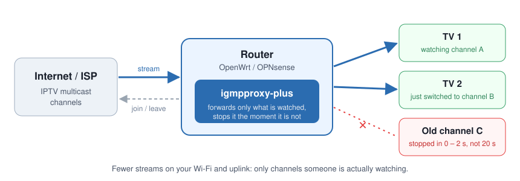
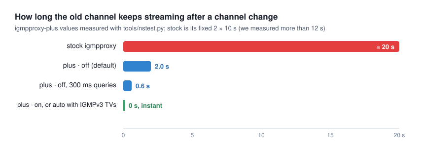

# igmpproxy-plus

**An IGMP proxy that stops multicast the moment you stop watching.**

[](https://github.com/Alpaca-The-Peacemaker/igmpproxy-plus/releases/latest)
[](https://github.com/Alpaca-The-Peacemaker/igmpproxy-plus/actions/workflows/release.yml)
[](COPYING)



## What it does

Devices use **IGMP** to ask for **multicast** streams: IPTV boxes for TV channels, but also
speakers, computers and other devices for multicast audio, video or data. When such a stream
comes from your internet provider, your router runs an **IGMP proxy**: it asks the provider for
the stream when a device wants it, and should stop it when no device needs it anymore. In most
homes that means IPTV.

igmpproxy-plus is a drop-in replacement for the standard `igmpproxy` on **OpenWrt** and
**OPNsense** (beta) that does this job much faster and gives you control over it:

- **Channels stop within 0 to 2 seconds** after a channel change, instead of about 20 seconds.
- **Fewer streams at once** on your Wi-Fi, switch and internet line while you zap.
- **Works with every device**: IGMPv1, v2 and v3, alone or mixed, and several devices on the
  same stream at once.
- **Settings and a live status page** in the router's web interface: who is watching which
  channel, and when each stream will stop.
- **Your existing settings keep working.** It reads the same configuration file.



## Why it was created

igmpproxy has quietly done its job on countless home routers for about twenty years. It is
small, dependable, and it is what OpenWrt and OPNsense ship as their IGMP proxy.

The trouble shows up with IPTV. When you change channel, the TV leaves the old channel and
joins the new one. With igmpproxy the old channel keeps streaming into your home for around 20
seconds: its leave timer is fixed at 10 seconds in the source code, and there is no setting to
change it. Zap through a few channels and several full TV streams run at once, which is
exactly what makes Wi-Fi and slower lines stutter.

Fixing that needed more than a small patch: a new timer engine, per-device tracking and new
defaults. That changes how the proxy behaves, and existing igmpproxy users rely on how it
behaves today. So rather than asking the igmpproxy project to rewrite its core, igmpproxy-plus
is a separate package you can install *instead of* igmpproxy, and remove again at any time.
igmpproxy itself stays exactly as it is.

All credit for the foundation goes to the igmpproxy authors, see [Credits](#credits).

## Install on OpenWrt

Works on **OpenWrt 24.10 and 25.12**. Prebuilt for x86_64, aarch64 (cortex-a53, cortex-a72,
generic), arm (cortex-a7, cortex-a9, cortex-a15), mips_24kc and mipsel_24kc, which covers most
current routers.

### 1. Install (backs up automatically)

Log in to your router over SSH and paste:

```sh
wget -O /tmp/install.sh https://github.com/Alpaca-The-Peacemaker/igmpproxy-plus/releases/latest/download/install.sh && sh /tmp/install.sh
```

What it does, step by step:

1. Detects your OpenWrt version and CPU type and downloads the matching packages.
2. **Saves a backup** to `/etc/igmpproxy-plus-backup/`: your `/etc/config/igmpproxy`, the
   version you had (stock igmpproxy or an older igmpproxy-plus), and whether it was running.
3. Replaces the stock `igmpproxy` package and adds the web interface pages.
4. Keeps your settings, restarts the proxy and checks that it runs.
5. **If anything fails, it rolls back on its own.**

Your TV may stutter for a second while the proxy restarts. You can read the script before
running it: [openwrt/install.sh](openwrt/install.sh).

> **Want a full router backup too?** Before installing, run
> `sysupgrade -b /tmp/router-backup.tar.gz` and copy that file to your computer. It contains
> your whole router configuration.

### 2. Restore the previous version

```sh
igmpproxy-plus-install rollback
```

This puts back exactly what you had before the last install or upgrade (stock igmpproxy or the
previous igmpproxy-plus) and your previous `/etc/config/igmpproxy`.

To go back to stock igmpproxy permanently:

```sh
igmpproxy-plus-install uninstall
```

To restore the optional full router backup: `sysupgrade -r /tmp/router-backup.tar.gz`, then
reboot.

### 3. Use it

- **Settings:** LuCI → Services → IGMP Proxy → Settings
- **Live status:** LuCI → Services → IGMP Proxy → Status, or `igmpproxy -S` over SSH. Shows
  each stream's bit rate and each device's bandwidth, and warns about problems found in the
  event log. **Refresh groups** asks every device to report what it receives right now
  (`igmpproxy -Q`).
- **Channel names:** Settings → Channel names. Load or paste your provider's channel list (M3U
  with rtp://, udp:// or udpxy links, or lines like `239.1.1.1 RTP 1`) and the pages show
  "RTP 1" instead of 239.1.1.1. Providers rarely publish these lists; users keep them up to date
  in forums. Stored in `/etc/igmpproxy-channels.m3u`, kept across upgrades.
- **Problem detection:** the Status and Events pages read the event log and point out, in plain
  words, streams that stopped while a device still wanted them (a black screen) and devices
  whose reports get lost.
- **Event history:** LuCI → Services → IGMP Proxy → Events: every join, leave, stream start
  and stop (with the reason), timeout and query, with device names. **Download log** gives the
  complete history as JSON Lines, one event per line, ready for a script or an AI assistant
  ("here is my IGMP log, why did the stream on 192.168.1.84 stop at 21:04?"). Over SSH:
  `igmpproxy -E`. Kept in RAM (`/tmp`), about one to two days per MiB; size and location are
  under Settings → Advanced.
- **Upgrade later:** `igmpproxy-plus-install` (backs up first, like the first install)
- **Check versions and the saved backup:** `igmpproxy-plus-install status`

## Install on OPNsense

> **Beta:** the OPNsense packages build and pass their checks, but have not yet been tested on
> a real OPNsense box. Try it on a test system first, and keep the rollback command handy.

Works on **OPNsense 26.7** (FreeBSD 15) and **25.7 / 26.1** (FreeBSD 14), amd64.

### 1. Install (backs up automatically)

Open a shell on OPNsense (SSH, or the console menu option 8) and paste:

```sh
fetch -o /tmp/install-opnsense.sh https://github.com/Alpaca-The-Peacemaker/igmpproxy-plus/releases/latest/download/install-opnsense.sh && sh /tmp/install-opnsense.sh
```

What it does, step by step:

1. Downloads the packages for your OPNsense version.
2. **Saves a backup** to `/conf/igmpproxy-plus-backup/`: a copy of `/conf/config.xml` and which
   IGMP proxy packages were installed.
3. Replaces the stock **IGMP Proxy** plugin (`os-igmp-proxy`) with **IGMP Proxy Plus**.
4. **Imports your stock IGMP Proxy settings** (interfaces, networks) so IPTV keeps working. The
   stock settings stay in your configuration, untouched.
5. Starts the proxy and checks that it runs. **If anything fails, it rolls back on its own.**

OPNsense also keeps every configuration change itself, under **System → Configuration →
History**.

### 2. Restore the previous version

```sh
igmpproxy-plus-install rollback
```

This puts back what you had before the last install or upgrade: the stock IGMP Proxy plugin
(which finds its old settings again) or the previous IGMP Proxy Plus. To go back to the stock
plugin permanently:

```sh
igmpproxy-plus-install uninstall
```

### 3. Use it

- **Settings and live status:** Services → IGMP Proxy Plus
- **Upgrade later:** `igmpproxy-plus-install`
- **Check versions and the saved backup:** `igmpproxy-plus-install status`
- As with the stock plugin, your firewall rules must allow IGMP and the multicast traffic
  (with "allow options" enabled on the rule).

## Recommended settings

**A stream is never stopped while another device that asked for it is still receiving it**, in
every mode. With several devices on the same stream (for example three IPTV boxes on one
channel), one changing channel or switching off does not interrupt the others. The modes only
decide how fast a stream stops once the **last** device has left it (Settings → Leave behaviour):

| Fast leave | When the last device leaves a stream | Good for |
|---|---|---|
| **off** (default) | Stops after the check (2 × 1 s by default) | Everyone; the most conservative |
| **on** | Stops instantly | Homes that want the fastest channel changes |
| **auto** | Instantly with IGMPv3 devices, after the check with IGMPv2 devices | Mixed or newer equipment |

Keep the **last member query interval at 1000 ms** unless you know your boxes answer quickly:
slow IPTV boxes need that time to answer the router's "anyone still watching?" check. The
Status page shows **"IGMPv2 host present"** next to channels watched by older (IGMPv2) boxes;
for those, the router sends its checks in IGMPv2 format automatically.

## Questions

**A stream is slow to start or shows no picture. Is it my network or the provider?**
Since 1.5.0 the Status page answers that. *Started in* shows how long the provider took to
deliver the first data after the router asked for the stream (event `first_packet`,
`start_delay_ms` in `igmpproxy -S`); starts slower than 3 s are listed as possible problems.
If devices are receiving a stream that carried data before and nothing arrives for 10 s, a red
note says so: the proxy has requested it, so the cause is upstream (provider, modem, cable).

**My smart home devices show up as streams.**
Discovery traffic stays local: UPnP/SSDP (239.255.255.250) and, since 1.5.0, CoAP
(224.0.1.187, used by IKEA, Shelly and others) are never requested from the provider. To go
further, *Settings > Channel names > Allow only these channels upstream* sets a group whitelist
from your channel list. Set-top boxes may need groups that are not in a channel list
(programme guide, updates), so test your TV afterwards.

**How many streams and devices can it handle?**
Plenty for a home with several TVs or a small office or event: every release build checks 100
streams and 30 receivers that all report at once (`tools/scale-test.py`). As a stress test it
also handled 500 streams and 100 receivers (about 1000 memberships arriving within 10 ms): all
500 streams flowing 0.3 s later, every leave stopped its stream in 2.0 s (with 2 × 1000 ms
checks) while the others kept flowing, 0.4 % CPU and 3 MB of memory. On Linux it raises
`net.ipv4.igmp_max_memberships` (default 20) to 1024 at start; before 1.4.1 only 20 channels
could be requested from the provider at the same time (option `maxmemberships`). It is a proxy: streams
come from the upstream side to the downstream networks. Sending streams between your own VLANs
(AV-over-IP encoders and decoders) needs PIM routing or IGMP snooping switches instead.
With hundreds of streams, turn off "Log periodic reports and queries" so the event log covers
more than a few hours.

**What does a line in the event log look like?**
```json
{"ts":"2026-11-09T21:04:05.123Z","ev":"leave","group":"239.1.1.1","if":"br-lan","host":"192.168.1.84","action":"keeps","others":1,"untracked":false,"mode":"off","compat_v2":true,"check_ms":0}
```
`ev` is one of `start`, `join`, `report`, `leave`, `leave_answered`, `forward_start`,
`forward_stop` (with `reason`: `fast_leave`, `no_answer` or `timeout`), `host_timeout`,
`compat_v2`, `upstream_join`, `upstream_leave`, `query` and `exit`. Times are UTC.

**A device I did not expect (a robot vacuum, a TV, a speaker) shows up in the list. Why?**
Many devices join multicast groups for discovery: UPnP/SSDP (239.255.255.250), mDNS (224.0.0.251)
or a vendor group. They are listed so you can see everything that asked; local discovery groups
are never requested from your provider, and they cost no internet bandwidth.

**I have several TV boxes on the same channel. Is that a problem?**
No. igmpproxy-plus tracks every box that asked for a channel and keeps the channel flowing as
long as any of them is still watching, even if a box is slow to answer (or ignores) the router's
checks. This is tested with up to three boxes on one channel, including a box that never answers.

**Which devices use IGMP? Does this affect Sonos, Chromecast, YouTube or Netflix?**
Many devices use multicast. IPTV boxes do, and speakers (Sonos, AirPlay), Chromecast, printers
and computers use it mostly for discovery *inside* your home. igmpproxy-plus only handles
multicast that comes **from your internet provider into your network**, which in practice means
IPTV. Multicast between devices inside your home never goes through it, and local discovery
groups are never forwarded to your provider. YouTube, Netflix and most streaming apps don't use
multicast at all.

**Does it work with my TV box?**
Yes. igmpproxy-plus supports IGMPv1, v2 and v3 devices, alone and mixed on the same network.
Every release is tested against 54 combinations of device versions, settings and multi-device cases
(`tools/compat-test.py`), and it runs on a real router with IGMPv2 IPTV boxes.

**Will my current settings be lost?**
No. It reads the same `/etc/config/igmpproxy` as igmpproxy, and the installer backs it up
before changing anything.

**What if something goes wrong?**
The installer rolls back automatically if the new version fails to install or start. You can
also roll back yourself at any time with `igmpproxy-plus-install rollback`.

**Does it send my home's traffic anywhere?**
No. It only forwards the multicast channels your devices ask for. Local-only discovery traffic
(UPnP/SSDP, mDNS, LLMNR) is never forwarded to your provider.

**Is it an official OpenWrt package?**
Not yet. It has been prepared for submission to the official OpenWrt package lists; until it is
accepted, install it with the command above.

## Credits

igmpproxy-plus is built on the work of the people below. Their code, copyright notices and
full commit history are kept in this repository, as the GPL asks and as they deserve.

- **Johnny Egeland** wrote igmpproxy in 2005.
- **Pali Rohár** and the igmpproxy contributors maintained and improved it for many years at
  [pali/igmpproxy](https://github.com/pali/igmpproxy). Every one of them is in this
  repository's history.
- **Carsten Schill** wrote smcroute 0.92, and **the Board of Trustees of Leland Stanford Junior
  University** published mrouted 3.9-beta3. igmpproxy is derived from both.
- The **OpenWrt** and **OPNsense** projects, whose igmpproxy packages and plugin showed how it
  should fit into each system.

igmpproxy-plus is an independent project. It is not affiliated with or endorsed by the
igmpproxy project or its authors. Please report problems with igmpproxy-plus
[here](https://github.com/Alpaca-The-Peacemaker/igmpproxy-plus/issues), not upstream.

Licences: the daemon is GPL-2.0-or-later (`COPYING`, `Stanford.txt`), the LuCI app is
Apache-2.0, and the OPNsense plugin is BSD-2-Clause.

---

## For advanced users

<details>
<summary><b>How fast is it: measurements</b></summary>

Measured with `tools/nstest.py`: Linux network namespaces, a sender at 50 packets/s, and two
receivers on one LAN segment. The time is how long multicast keeps arriving after a leave.

| Configuration | Traffic after the only receiver leaves | Second receiver on the same segment when the first leaves |
|---|---|---|
| stock igmpproxy 0.4 | still flowing when the 12 s window ended (about 20 s expected) | no gap |
| stock + `quickleave` | still flowing when the 12 s window ended | no gap |
| plus, `fastleave off` (2 × 1 s) | **2.0 s** | no gap |
| plus, `fastleave off` (2 × 300 ms) | **0.6 s** | no gap |
| plus, `fastleave on` | **0 s** | no gap (the other box is still tracked) |
| plus, `fastleave auto` (IGMPv3 hosts) | **0 s** | no gap (both hosts tracked) |

Since 1.1.0 the proxy sends **IGMPv3 queries** (igmpproxy sends IGMPv2). Hosts then stay in
IGMPv3, where every host reports and every host sends its leave, so host tracking and `auto`
are exact even without IGMP snooping. With `queryversion 2`, or while an IGMPv1/v2 host is
present, a host that hears another host's report stays quiet and may send no leave, so the
host list can be incomplete: `auto` then behaves like `off` and checks with group specific
queries before stopping. In every mode a stream keeps flowing while any other tracked host is
on it, even one that has been quiet for a long time (a quiet IGMPv2 host is indistinguishable
from a powered-off one, so it is kept until the membership timeout).

</details>

<details>
<summary><b>What changed compared to igmpproxy 0.4</b></summary>

| Stock igmpproxy 0.4 | igmpproxy-plus |
|---|---|
| Last member query interval is hard-coded to **10 s**. With 2 queries, traffic keeps flowing for about 20 s after a leave. | Configurable from 100 ms to 25.5 s. Default **1 s** (the RFC 2236 value). |
| Timers tick in whole seconds. | Millisecond timers. |
| `quickleave` only sends the *upstream* leave early. Downstream forwarding continues until the group ages out. | `fastleave` stops *downstream* forwarding on that interface at once: `off`, `on` or `auto`, set globally or per interface. |
| A leave queries **every** downstream interface and ages the whole group. | Leaves are handled per interface. Other interfaces are not affected. |
| Host tracking uses a lossy hash (`hashtablesize`), so it can't tell when the last host is gone. | Exact per-host list per group and interface, each host with its own timer. |
| Robustness, query interval and response interval are fixed. | All configurable, with per-interface overrides. |
| IGMPv2 queries only, so hosts suppress each other's reports. | IGMPv3 queries by default (`queryversion`), with IGMPv1/v2 host compatibility per group (RFC 3376). |
| Link-local groups (224.0.0.x, e.g. mDNS) are joined upstream. | Link-local groups are never proxied; SSDP is kept local unless enabled. |
| No status output. | Live JSON group table: `igmpproxy -S`, and the status pages in LuCI and OPNsense. |
| — | `upstreamleavedelay`: stays joined upstream for a while, so switching back to a channel is instant. |
| — | Upstream IGMP version can be forced (v2/v3) from the UI. |

**Fast leave modes**

- **off**: RFC 2236 behaviour. After the last tracked host leaves, the proxy sends
  `lastmembercount` group-specific queries, `lastmemberinterval` apart. If nobody answers, it
  stops forwarding on that interface. Worst-case stop time = count × interval (default 2 × 1 s).
- In **every** mode, a leave from one host never stops the group while other hosts that reported
  it on that interface have not left (explicit host tracking). IGMPv2 hosts that stay quiet
  because another host answered (report suppression) stay tracked.
- **on**: stops forwarding on that interface as soon as the last tracked host leaves. While other
  hosts that reported the group have not left, it keeps flowing.
- **auto**: stops at once when the leaving host was the last host the proxy saw on that
  interface, otherwise behaves like `off`. With IGMPv3 queries every host is seen. If an
  IGMPv1/v2-only device reports, that group falls back to `off` on that interface until the
  device goes quiet. Above `hostlimit` hosts it also falls back to `off`.

</details>

<details>
<summary><b>Configuration reference</b></summary>

Times in `igmpproxy.conf` accept `500ms`, `2s`, a plain number of seconds (`0.5`) or `2m`.
**Global options must come before the first `phyint`.** Options inside a `phyint` block
override the global value for that interface.

| igmpproxy.conf | OpenWrt UCI (`/etc/config/igmpproxy`) | OPNsense field | Default |
|---|---|---|---|
| `fastleave off\|on\|auto` (global + phyint) | `fastleave` | Fast leave | off |
| `lastmemberinterval` (global + phyint) | `last_member_interval` (ms) | Last member query interval (ms) | 1s |
| `lastmembercount` (global + phyint) | `last_member_count` | Last member query count | robustness |
| `robustness` (global + phyint) | `robustness` | Robustness | 2 |
| `queryversion 2\|3` (global + phyint) | `query_version` | Query version | 3 |
| `queryinterval` | `query_interval` (s) | Query interval (s) | 125s |
| `queryresponseinterval` | `query_response_interval` (s) | Query response interval (s) | 10s |
| `startupqueryinterval` / `startupquerycount` | `startup_query_interval` / `startup_query_count` | Startup query interval / count | QI/4, robustness |
| `grouptimeout` (phyint) | `group_timeout` (s) | Group membership timeout (s) | robustness×QI+QRI |
| `upstreamleavedelay` | `upstream_leave_delay` (ms) | Upstream leave delay (ms) | 0 |
| `hostlimit` | `host_limit` | Tracked hosts limit | 256 |
| `controlsocket` | (fixed `/var/run/igmpproxy.sock`) | (fixed `/var/run/igmpproxy-plus.sock`) | /var/run/igmpproxy.sock |
| — | `upstream_igmp_version` (sets `force_igmp_version` on the upstream device) | System IGMP version (`net.inet.igmp.default_version`) | auto |
| `blacklist 239.255.255.250/32` added to each downstream | `proxy_ssdp` (0 = keep SSDP local) | Proxy SSDP | SSDP not proxied |
| — | `verbose` (1 warnings, 2 info, 3 debug) | Log level | 1 |
| `quickleave` (legacy) | `quickleave` (legacy) | — | = `fastleave auto` |
| `hashtablesize` (legacy) | — | — | ignored |

Your existing OpenWrt `/etc/config/igmpproxy` works unchanged. `quickleave '0'` means fast
leave is off, but leaves are now detected in about 2 s instead of about 20 s, because the 1 s
last member interval replaces the old 10 s.

</details>

<details>
<summary><b>Building from source and testing</b></summary>

**Daemon on Linux**

```sh
./autogen.sh && ./configure && make
sudo ./src/igmpproxy -t igmpproxy.conf        # config check
sudo ./src/igmpproxy -d -v -v igmpproxy.conf   # foreground with debug logging
sudo ./src/igmpproxy -S                        # live group table (JSON)
```

**Tests** (Linux, root; they use network namespaces)

```sh
sudo python3 tools/nstest.py ./src/igmpproxy plus-auto "fastleave auto"   # leave times
sudo python3 tools/compat-test.py ./src/igmpproxy                         # IGMPv1/v2/v3 matrix
sudo python3 tools/linklocal-test.py ./src/igmpproxy                      # 224.0.0.x never proxied
sudo python3 tools/robustness-test.py ./src/igmpproxy                     # status clients that hang up
sudo sh tools/test-installer.sh                                           # installer, throwaway box only
```

**OpenWrt packages** with the official SDK for your release and target:

```sh
sh tools/openwrt-build.sh 25.12.6 mediatek/filogic out    # release, target/subtarget, output dir
```

Or add `openwrt/` as a feed in your own SDK:

```sh
git clone https://github.com/Alpaca-The-Peacemaker/igmpproxy-plus.git
echo "src-link igmpplus $PWD/igmpproxy-plus/openwrt" >> feeds.conf.default
./scripts/feeds update -a && ./scripts/feeds install igmpproxy-plus luci-app-igmpproxy-plus
make package/igmpproxy-plus/compile package/luci-app-igmpproxy-plus/compile V=s
```

**OPNsense** (FreeBSD build host with the same major version as OPNsense; not tested yet):

```sh
cp -r opnsense/port/net/igmpproxy-plus /usr/ports/net/
cd /usr/ports/net/igmpproxy-plus && make makesum && make package
# plugin: inside a checkout of github.com/opnsense/plugins
cp -r opnsense/net/igmp-proxy-plus net/ && cd net/igmp-proxy-plus && make package
```

**Repository layout**

```
configure.ac, src/, doc/              the daemon (igmpproxy fork, upstream history kept)
openwrt/net/igmpproxy-plus/           OpenWrt package
openwrt/luci/luci-app-igmpproxy-plus/ LuCI settings + live status pages
openwrt/install.sh                    one-line installer with backup and rollback
opnsense/                             OPNsense plugin and FreeBSD port
tools/                                build script and tests
docs/                                 illustrations and plans
```

</details>

## Roadmap

- OPNsense: test on real hardware, then drop the beta label
- Official OpenWrt and OPNsense package submission
- Source-specific multicast (RFC 4605 source filtering), only if someone needs it
